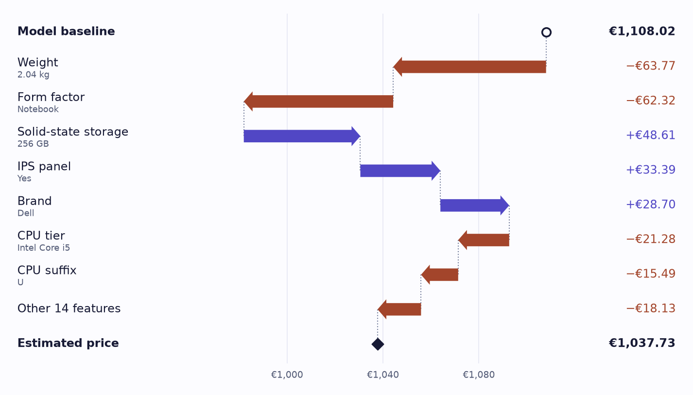

# SpecWorth

Evaluate a used laptop listing. Compare the seller’s price with recent used prices, check whether the hardware fits your workload, and see exactly what moved the model’s retail catalog estimate.



## Explore the explanation

- **Evaluate a used listing** takes the seller’s asking price, reported condition, and intended workload. Enter three comparable prices from the same market and condition. Completed sales provide stronger evidence than seller quotes.
- **Pricing strategy report** shows how the offer compares with your comparables, what the hardware is suitable for, and what to verify or negotiate. The catalog estimate is a historical benchmark. The used price verdict comes from the prices you enter.
- **This laptop** shows the seven largest feature contributions. The remaining contributions share one row. Select **Show every feature** to expand the chart.
- **Inspect a feature** shows its selected value, signed contribution, and the middle 80% of contributions observed on held-out laptops. Open the underlying inputs to see which category indicators were active or absent.
- **Across laptops** ranks features by their mean absolute contribution over the 258 held-out configurations. Use the sidebar to compare full predictions when evaluating a hardware change.
- **Generate detailed buyer analysis** keeps the price verdict and euros tied to the app’s calculations. Gemini adds context about hardware trade-offs and negotiation. It receives the listing inputs and valuation evidence. If Gemini is unavailable, the button still returns a complete report based on what you entered.

For a quick demo, keep the default hardware, enter a €300 asking price, and enter €275, €310, and €340 as sample completed sales. The offer is €10 below their median. Choose **Modern gaming** to see how a competitive price can still be a poor match for the selected use.

## Model performance

The XGBoost regressor was fitted on 1,045 of the catalog’s 1,303 rows. Configurations with identical broad hardware specs were kept together. Candidate selection used two repetitions of grouped five-fold cross-validation on the development set. CPU and GPU line features let the trees share information between related components.

| Evaluation | Mean absolute error |
| --- | ---: |
| Repeated grouped cross-validation | €158.23 |
| Separate five-fold check holding out named products within the development set | €180.84 |
| 258-row configuration holdout | €191.38 |

Holdout R² was 0.808. The **Model and evaluation** section shows the cumulative absolute error curve. About 90% of the 258 holdout predictions were within €462 of the recorded catalog price. The same holdout has been used across project revisions. This curve describes catalog prediction errors. Current resale decisions also depend on condition, location, and recent sales.

## Run locally

Use Python 3.14 in a virtual environment.

```shell
python -m pip install -r requirements.txt
python -m unittest -v test_pricing
python -m streamlit run app.py
```

For the optional Gemini buyer analysis, set `GEMINI_API_KEY` in your local `.streamlit/secrets.toml`. The estimator, SHAP explorer, and pricing strategy report run locally with the model archive.

## Deploy to Streamlit Community Cloud

Select `app.py` as the entry point, choose Python 3.14 under Advanced settings, and enter `GEMINI_API_KEY` in the app’s Secrets settings to enable the Gemini buyer analysis. Keep the local secrets file private. The published project serves the model and evaluation data in `laptop_model.zip`. The training script and source catalog are kept in the original local workspace.
